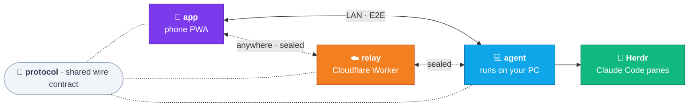

<p align="center">
  <picture>
    <source media="(prefers-color-scheme: dark)" srcset=".github/assets/banner-dark.png">
    
  </picture>
</p>

<h3 align="center">Your coding agents, in your pocket.</h3>
<p align="center">Chat with the Claude Code sessions running in <a href="https://herdr.dev">Herdr</a> — by text, voice or photo.</p>

<p align="center">
  
  
  
  
</p>

<!-- Demo GIF goes here once the new design ships:
<p align="center"></p>
-->

## ✨ Why remote-sheep

|          💬 **Chat anywhere**           |             🎙️ **Talk to it**             |          🔔 **Know when it's done**          |           🔒 **Private by design**           |
| :-------------------------------------: | :---------------------------------------: | :------------------------------------------: | :------------------------------------------: |
| Every session from Herdr, on your phone | Dictate orders, hear replies, send photos | A push the moment a session finishes or asks | End-to-end encrypted. The relay sees nothing |

## 🧭 How it works



## 🚀 Quick start

Needs Node 22+ and a running Herdr.

```sh
pnpm install && pnpm build && pnpm start
```

Scan the QR with your phone. That's it.

## 🐑 Run as a Herdr plugin

Herdr can keep the agent running in the background, with no tab. From a checkout, built as above:

```sh
herdr plugin link /path/to/remote-sheep
```

Herdr starts it on its own start; the actions `start`, `stop` and `status` do it by hand
(`herdr plugin action invoke sheepvibecoder.remote-sheep.status`), and so do
`remote-sheep start|stop|status` outside Herdr. Start leaves an agent that already runs alone.
The plugin keeps its data, its PID (`agent-process.json`) and its log (`agent.log`) in the state
folder Herdr gives it; `REMOTE_SHEEP_HOME` still wins when set.

To pair, run the action **Show pairing QR** (`sheepvibecoder.remote-sheep.qr`), or
`remote-sheep qr` in any terminal. It opens a pane with a new QR code and its links: scan the QR
with the phone, or, to use remote-sheep in a browser on this PC, open the link labelled
"On this PC's browser" (`http://127.0.0.1:<port>/#pair=…`). Enter shows a new code, q or Esc
closes the pane, and the agent keeps running; only `stop` stops it. The agent's log never holds
a pairing link.

The first start listens on port 3999, or on the next free port up to 4049 when 3999 is taken,
and saves it (`port.json`), so the phone's address stays the same; `status` shows the port in
use. To change it, run `remote-sheep port 4100` (any port from 1024 to 65535), then
`remote-sheep stop` and `remote-sheep start`, or restart Herdr. `remote-sheep port` shows the
port and where it comes from, and `remote-sheep port auto` lets the next start pick again. The
`PORT` variable still overrides the saved port.

<p align="center">
  <a href="docs/">Docs</a> ·
  <a href=".github/SECURITY.md">Security</a> ·
  <a href=".github/CONTRIBUTING.md">Contributing</a> ·
  <a href="LICENSE">License</a>
</p>
