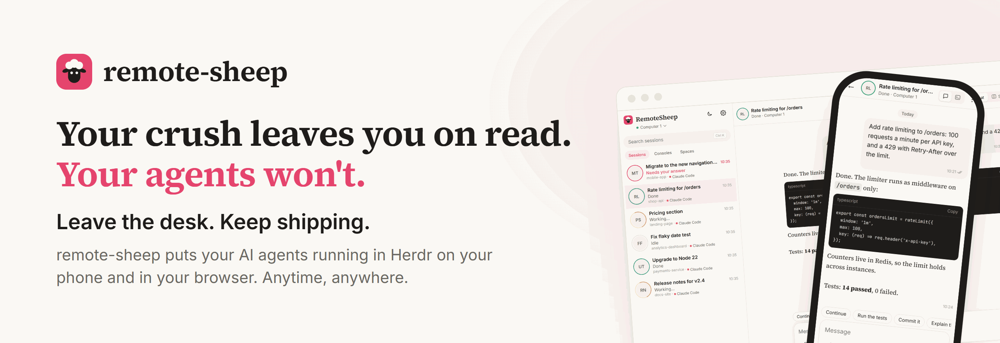
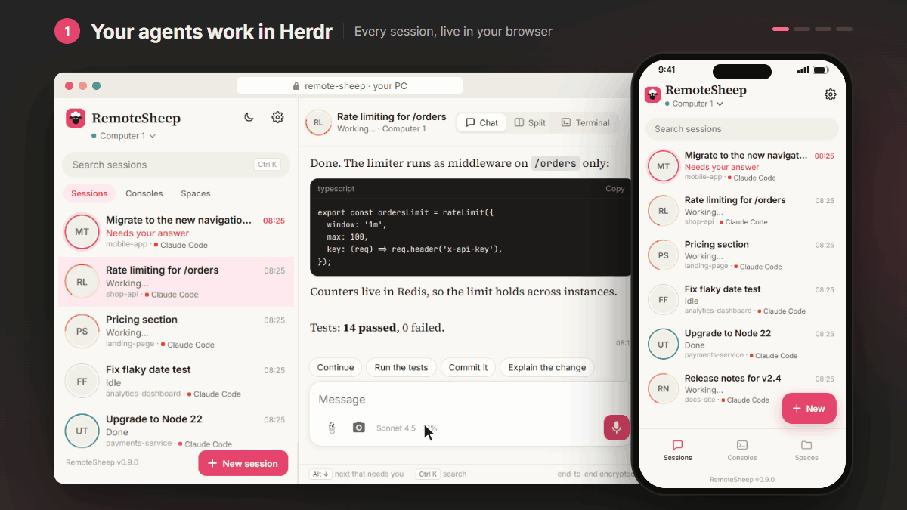
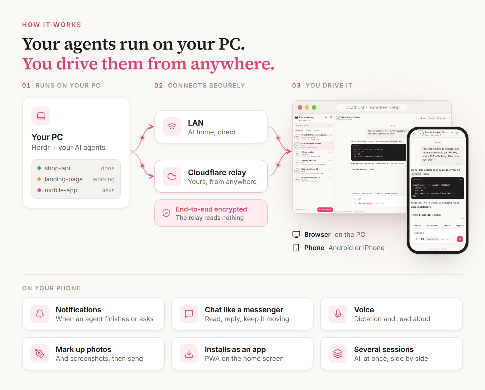

<p align="center">
  <picture>
    <source media="(prefers-color-scheme: dark)" srcset=".github/assets/banner-dark.png">
    
  </picture>
</p>

<p align="center">
  
  
  
  
  
  
  
  
</p>

<p align="center">
  
</p>

## ⚙️ How it works

<p align="center">
  <picture>
    <source media="(prefers-color-scheme: dark)" srcset=".github/assets/how-it-works-dark.png">
    
  </picture>
</p>

## 🐑 Why remote-sheep

- **Your agents never wait for you** — a notification the moment one finishes or asks something;
  answer in seconds and it is back at work while you are in a meeting, on the bus or on the couch.
- **Run several sessions at once** — see them all, jump to the one that needs you, keep the rest
  going.
- **Web and phone in one install** — the same app on the PC's browser and on your phone.
- **Two steps, no setup** — install the plugin, open a link. No account, no password.
- **From anywhere, without a VPN** — a free relay in your own Cloudflare account; no Tailscale,
  no port forwarding.
- **End-to-end encrypted** — even the relay cannot read your code or your chats.
- **Voice, photos and notifications** — built for the moments you are away from the keyboard.
- **Runs itself** — starts with Herdr, picks a free port, updates from the app.

## 🚀 Get started in two steps

You need [Herdr](https://herdr.dev) 0.9.5 or newer, [Node.js](https://nodejs.org) 22+ and
[pnpm](https://pnpm.io).

**1. Install the plugin**

```sh
herdr plugin install sheepvibecoder/remote-sheep
```

Herdr builds it and starts it in the background. A notification tells you the address:
**remote-sheep ✓ — open http://localhost:3998**.

**2. Open it**

- **On this PC:** open that address in your browser. It pairs at once — no QR, no password.
- **On your phone:** in that page, open **Settings → Add a device** and scan the QR code.

<!-- TODO: record install.gif once the repository is public.
<p align="center">
  
</p>
-->

That's it. Updates come from the app: **Settings → Update**.

## 🌍 Use it away from home (optional)

On your home network it just works. To reach your PC from anywhere, deploy your own relay: a free
Cloudflare Worker that forwards end-to-end encrypted messages and can read none of them.

```sh
git clone https://github.com/sheepvibecoder/remote-sheep && cd remote-sheep
pnpm install
cd packages/relay && npx wrangler login && npx wrangler secret put ACCESS_CODES && cd ../..
pnpm relay:deploy
```

Then open **Settings → Relay** in the app and paste the relay's address and your access code. The
PC connects at once, and new QR codes pair phones through the relay. Step by step:
[docs/guide.md](docs/guide.md#relay).

## 🔒 Private by design

- Browser, phone and PC talk **end-to-end encrypted**; the relay only forwards sealed messages.
- **No account, no cloud of ours:** everything runs on your PC and, if you want it, your own
  Cloudflare account.
- Only a browser **on your own PC** pairs without a QR; anyone else needs the QR you show them.

## ❓ Troubleshooting

<details>
<summary><b>I never see the Herdr notification (Windows)</b></summary>

Send Herdr's notifications to Windows: add this to `%APPDATA%\herdr\config.toml`, then run
`herdr server reload-config`. They appear in the Windows notification center (as a banner unless
Do not disturb is on).

```toml
[ui.toast]
delivery = "system"
```

</details>

<details>
<summary><b>Port 3998 is already used</b></summary>

Nothing to do: remote-sheep takes the next free port, remembers it, and the notification shows
the right address. To pick another one, open **Settings → Port**.

</details>

<details>
<summary><b>Commands, if you prefer the terminal</b></summary>

Every action is also a Herdr action: `start`, `stop`, `status`, `restart`, `qr` and `relay`.

```sh
herdr plugin action invoke sheepvibecoder.remote-sheep.status
```

</details>

## 📚 More

- [User guide](docs/guide.md) — every setting, the relay, running it without the plugin.
- [Architecture](docs/architecture.md) — how it is built: an Angular app, a Node agent and a
  Cloudflare relay, in TypeScript.
- [Security](.github/SECURITY.md) · [Contributing](.github/CONTRIBUTING.md)

## 📄 License

Free to use, at home or at work, under the [remote-sheep Free Use License](LICENSE). It may not be
sold or redistributed. © sheepvibecoder.
