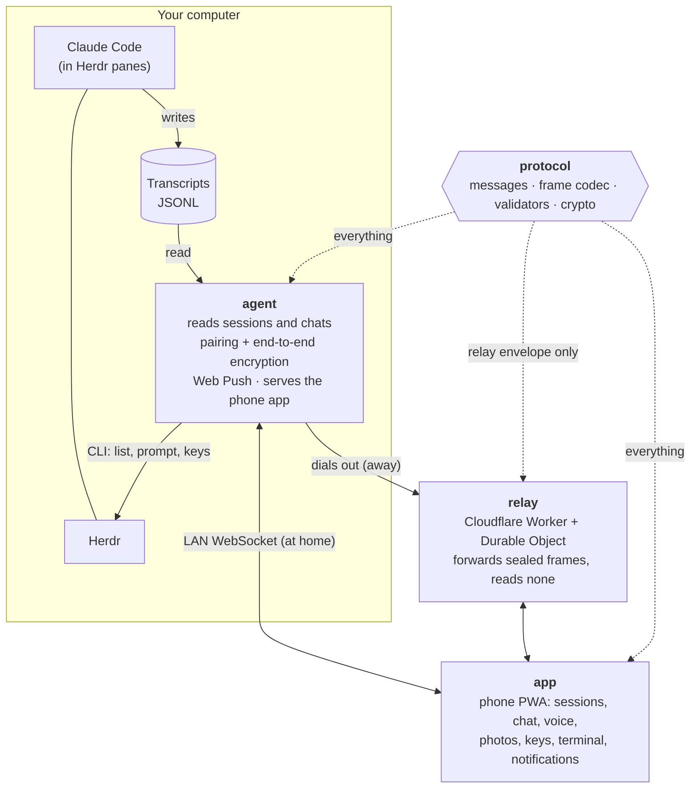

# User guide

Drive the coding agents running in [Herdr](https://herdr.dev) from your phone,
by chat and voice.

The phone is a bell and a microphone, not a monitor: each session shows up as
a chat read from the agent's own transcript, you dictate the next order, and
the reply can be read aloud. The raw terminal is one tap away for the moments
a chat cannot show, such as a permission prompt.

> Works on your local network, or from anywhere through a relay you deploy
> yourself. Phones pair by QR and every message is end-to-end encrypted.

## Run it

```
pnpm install
pnpm build
pnpm start
```

It prints a QR code. Scan it with your phone, on the same network as the
computer running Herdr, and the phone is paired.

### Pairing

- Each QR code pairs one phone and expires after 5 minutes. Press Enter where
  remote-sheep runs for a new one.
- Every connection runs a fresh key exchange (X25519, triple Diffie-Hellman)
  and every frame is sealed with ChaCha20-Poly1305. Only the phone and this
  computer hold the keys.
- A pairing expires 24 hours after its last use or 7 days after it was made,
  whichever comes first. The phone then asks for a new QR code.
- `remote-sheep devices` lists paired phones; `remote-sheep revoke <id>`
  unpairs one, and a running agent disconnects it within 5 seconds.

### On the phone

The app looks like a messaging app. The home screen lists the sessions as
chats; **Sessions** and **Spaces** switch between them and the Herdr
workspaces, and the search box narrows either by name. Tapping a space shows
only its sessions. The **+** button opens a sheet where you pick **Claude Code**, **Codex** or **Console**, then the
workspace: it starts that in a new tab and opens it. Codex has no chat yet, so it opens on its terminal. A number on a session counts how many
times it finished or stopped to ask while its chat was not on screen; opening
the chat clears it. Settings live behind the **⋮** menu of the list: **Settings** (the accent colour, with five to
choose from, your reply styles and quick replies, the reading speed, profiles, linked devices, the
theme and the text size) and **Check for updates**.
Every screen shows the version at the bottom; **Check for updates** compares it
with the `version.json` the server now serves and offers to reload when it is newer.

In a chat, type or dictate with the microphone, attach a photo from the gallery with the clip or take one with the camera,
and open the raw terminal with **$**. While a session waits for an answer, or
the terminal is open, **esc**, **tab**, **↑**, **↓** and **⏎** appear above the message box, with
**Stop** (Ctrl+C) apart from them: they answer Claude Code's menus. When the terminal shows a
numbered question ("1. Yes 2. No"), each answer is a button of its own above the keys.

Each message shows the hour it was written, with a line for each day (**Today**, **Yesterday**,
then the date). What you send gets one tick once Herdr takes it and two once it shows up in the
transcript. The model answering in the chat, such as **Opus 5.5**, appears next to the microphone.

The **⋮** of a chat names the model and holds the **reply style** every order carries: **Off**,
**One line** (the default), **Explain simply**, **10 lines max** or **En español**. You write your own in **Settings**: a name and the words to append to the order; every style can be edited or deleted, except **Off**, and **Reset styles** brings the first ones back. The style
picked shows as a chip next to the microphone; tap it to change it. It is kept for each computer.
**Read replies aloud** is there too.

Above the message box, the quick replies (at first **Continúa**, **Corre los tests**, **Haz commit**
and **Explícame el cambio**) send that order with one tap, with the reply style, and leave what you were typing in the
box. **Quick replies** in the chat's **⋮** hides or shows them. In **Settings** you write your own
(up to eight), edit or delete any of them, and **Reset replies** brings these four back. Code in a reply appears in a dark
block with a **Copy** button.

### On a computer

On a window 900 px wide or more, the list stays on the left and the open chat or terminal fills
the right, so you can move between sessions without going back. The open session is highlighted in
the list.

Shortcuts: **Ctrl K** goes to the search, and **Alt ↓** opens the next session that waits for an
answer, wrapping around. The tab title shows how many sessions have something unread, for example
`(2) RemoteSheep`.

### Consoles

A console is a Herdr pane running a plain shell, with no Claude Code in it. It runs any
command on the computer, so you can turn consoles off in **Settings**, under **Consoles**; they start
on, and the choice is kept on the computer in `settings.json`. When they are on, a **Consoles** tab next to **Sessions** lists them,
each with a dark **$** avatar, so they never mix with the Claude Code chats; and **Console** in the **+** sheet starts one in the workspace you pick. A
console opens on its terminal: what you send runs as a command, followed by Enter, and the
keys above the message box reach the shell.

### Several computers

One phone can be paired with several computers, say one at home and one at the
office: each is a profile, and their sessions, badges and chats never mix. The home
screen is titled with the profile it shows, and a chat names it next to its status;
after a switch the app says **Now on …**.

The **⇄** button on the home screen (or **⋮ → Profiles**) lists them with whether
each answers right now (**online** or **offline**, for example when `pnpm start` is
not running at the office); tapping one switches to it. **Scan a QR code to add a
computer** opens the camera inside the app, as the scan screen does, so a new computer
joins the installed app instead of opening another browser tab (Chrome on Android;
elsewhere, scan with the phone camera). **Rename** and **Remove** are there too;
removing the computer on screen also unlinks this phone from it. A tapped notification
opens the computer it came from. When a pairing expires, the scan screen offers the
other computers. The screen is a placeholder until the phone UI is redesigned.

The browser keeps the profiles per address, so they share one list only when the
app is always opened from the same one: the relay. Opened from a computer's LAN
address, the app knows only that computer.

### Linked devices

**⋮ → Linked devices** shows every phone paired with
this computer: its id, when it paired, when it was last used, when its pairing
expires, and which one is this phone. **Unlink** does exactly what
`remote-sheep revoke <id>` does; unlinking this phone takes it back to the
scan screen. Open phones see the list change after a pairing or an unlink.
A phone that scans a new QR replaces its old entry instead of adding another.
The screen is a placeholder until the phone UI is redesigned.

### Notifications

When a session goes from working to done or blocked and no connected phone
has that chat open, every phone that switched notifications on gets
`<project>: finished` or `<project>: waiting for your answer`. Tapping it
opens that chat. Nothing from the transcript is sent.

- **Needs a relay.** Push works only on https, so open the app from the
  relay's address. Plain LAN http cannot use it, and without a relay the
  agent sends no push. On an iPhone, add the app to the home screen first.
- **Switch it on** in **⋮ → Linked devices → Notifications**. Where it cannot work, the
  switch says why.
- **What the agent keeps.** One push subscription per paired device, inside
  `devices.json`. It is removed when the device is unlinked, revoked or its
  pairing expires, or when the push service says it is gone. The agent's
  VAPID keys live in `~/.remote-sheep/vapid.json`, created on first use.
- **Cost.** With a relay configured the agent asks Herdr for the session
  list every 2 seconds even with no phone open, so it can notice a session
  settling.

### https

Frames are encrypted either way, but over plain http someone on the network
could alter the page itself. Put `cert.pem` and `key.pem` in
`~/.remote-sheep/` and the agent serves https on its own:

```
openssl req -x509 -newkey rsa:2048 -nodes -keyout key.pem -out cert.pem \
  -days 825 -subj "/CN=remote-sheep" \
  -addext "subjectAltName=IP:<this machine's LAN ip>,IP:127.0.0.1,DNS:localhost"
```

A self-signed certificate warns once and blocks installing the app to the
home screen; a real certificate removes both.

### Settings

Set them in the shell, or once in a `.env` file (`NAME=value` per line) in the folder
`pnpm start` runs from; the file is ignored by git, and a variable set in the shell wins.

| Variable            | Default                          |                                                                       |
| ------------------- | -------------------------------- | --------------------------------------------------------------------- |
| `PORT`              | `3999`                           | Port the phone connects to                                            |
| `HERDR`             | `herdr` (`herdr.exe` on Windows) | Herdr executable                                                      |
| `REMOTE_SHEEP_HOME` | `~/.remote-sheep`                | Agent key, paired phones, VAPID keys, certificate and uploaded photos |

### Relay

A relay lets the phone reach the agent from outside your network. It runs as
a Cloudflare Worker in your own Cloudflare account and only forwards frames:
they are sealed end to end, so the relay cannot read them. It also serves the
phone app over https. Without a relay everything works on the LAN as before.

Deploy it (the free plan is enough). The first time, log in and set the access
codes (one per person, comma-separated) inside `packages/relay`:

```
cd packages/relay
npx wrangler login
npx wrangler secret put ACCESS_CODES
cd ../..
pnpm relay:deploy                           # builds the app, then deploys the relay
```

For a nicer address, add a custom domain to the Worker in the Cloudflare
dashboard (for example `relay.<your-domain>`). Nothing in this repository
names a relay; it uses whichever account you are logged into.

Tell the agent about it once; it is kept in `~/.remote-sheep/relay.json`
(owner-only) and every start uses it:

```
pnpm start relay set https://<your relay> <your code>
pnpm start relay          # show it, with the code masked
pnpm start relay off      # forget it: LAN only
```

The environment variables `REMOTE_SHEEP_RELAY` and `REMOTE_SHEEP_RELAY_CODE`
still work and override the saved relay when set.

Daily flow: change code, `pnpm build`, `pnpm start`. Run `pnpm relay:deploy`
only when the phone app or the relay itself changed.

The agent dials out to the relay, reconnects on its own and still serves the
LAN. The QR code now points at the relay, and a pairing belongs to one
address, so the phone must pair again under it.

**One relay for a team.** Give each person their own code. Each agent gets its
own room, and a room stays with the code that claimed it. Removing a code
from `ACCESS_CODES` frees its room. Phones need no code: their pairing is
their authorization.

**Free-plan limits.** The plan allows 100,000 Durable Object requests per day
per account, shared by everyone on the relay, and every incoming WebSocket
message counts. An idle relay costs nothing: it hibernates, and keepalive
pings are answered without waking it. A terminal left open is the main
consumer.

| Answer            | Meaning                                                                                 |
| ----------------- | --------------------------------------------------------------------------------------- |
| HTTP `403`        | To an agent: access refused (missing, unknown or foreign code); the agent stops trying. |
| HTTP `503`        | To a phone that connects while its agent is offline; the phone retries.                 |
| close code `4010` | To a phone whose agent drops while connected; the phone retries.                        |

## How it fits together



## Layout

```
packages/
  protocol/   shared kernel: every message between phone and agent, its codec and validator
  agent/      runs next to Herdr; the npx package
    src/L1_domain/        ports (Multiplexer, TranscriptSource, Link, Notifier...) and domain rules
    src/L2_application/   the core: session monitor and hub, who watches what, what changed
    src/L3_periphery/     adapters: herdr, claude transcripts, LAN link, secure channel, files, CLI
    src/main.ts           composition root
  app/        the phone app (Angular)
    src/L1_domain/        ports and pure rules
    src/L2_application/   app store: state and rules, no DOM
    src/L3_periphery/     WebSocket connection to the agent
    src/LR_render/        the view
  relay/      the Cloudflare Worker relay (deployed with wrangler)
    src/L1_domain/        ports (room sockets, room store, access codes)
    src/L2_application/   RelayRoom: the rules of one agent's room
    src/L3_periphery/     Worker, Durable Object and Cloudflare adapters
    src/main.ts           composition root
```

Each layer imports only the ones below it, and ESLint fails the build when one
does not (see [architecture.md](architecture.md)). Supporting tmux, Codex, or
reaching the phone another way is a new adapter, not a change to the core.

## How it stays quiet

The phone never polls. The agent asks Herdr for the session list once every
two seconds for all phones, and only while one is connected (with a relay it
does so always, to send notifications). The chat of a
session is pushed when its transcript file changes. Only the raw terminal is
read on a timer, because there is no file to watch, and only while it is open.

## How a chat is read

1. Herdr gives the pid of the agent process in the pane.
2. `~/.claude/sessions/<pid>.json` gives its session id.
3. `~/.claude/projects/<flattened cwd>/<session id>.jsonl` is the transcript.
4. The text blocks of user and assistant entries are kept; subagent traffic,
   tool results, injected reminders and the summary replayed after a
   compaction are dropped.

## Develop

```
pnpm test        # Vitest, all packages
pnpm typecheck
pnpm --filter @remote-sheep/relay dev      # the relay locally (wrangler dev)
pnpm relay:deploy                          # build, then deploy the relay to your Cloudflare account
```
