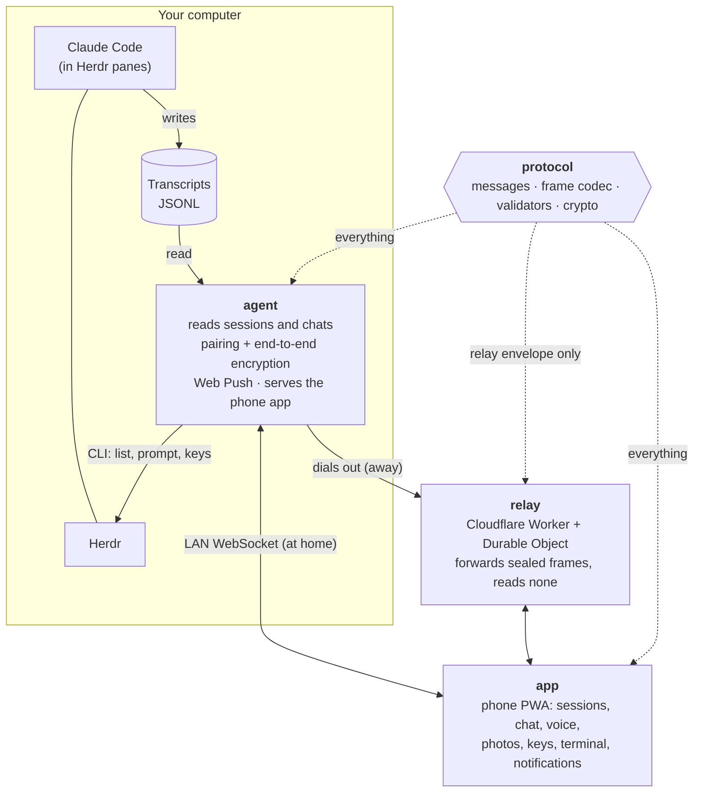

# User guide

Drive the coding agents running in [Herdr](https://herdr.dev) from your phone,
by chat and voice.

The phone is a bell and a microphone, not a monitor: each session shows up as
a chat read from the agent's own transcript, you dictate the next order, and
the reply can be read aloud. The raw terminal is one tap away for the moments
a chat cannot show, such as a permission prompt.

> Works on your local network, or from anywhere through a relay you deploy
> yourself. Phones pair by QR and every message is end-to-end encrypted.

## Run it

```
pnpm install
pnpm build
pnpm start
```

It prints a QR code. Scan it with your phone, on the same network as the
computer running Herdr, and the phone is paired. To use it in a browser on the
same computer instead, open `http://localhost:<port>` (the port it prints): the
page pairs itself with no QR and shows the sessions.

### Pairing

- Each QR code pairs one phone or browser and expires after 5 minutes. Press
  Enter where remote-sheep runs for a new one.
- When the agent runs in the background (`remote-sheep start`, or the Herdr
  plugin), run `remote-sheep qr` or the plugin action **Show pairing QR**. It
  asks the running agent for a new QR code and links over a control channel
  that only this computer can reach (a loopback port and a secret in
  `control.json`, readable by you alone). Enter shows a new one; q or Esc
  closes it, and the agent keeps running. The background agent's log never
  holds a pairing link.
- A page opened from the agent at `http://localhost:<port>` or
  `http://127.0.0.1:<port>` in a browser on this computer, with no pairing yet,
  pairs itself: it asks the agent that served it for an invite (`POST
/local-pairing`). The agent answers only a request that comes over loopback,
  names its own `localhost` or `127.0.0.1` address as the Host (which stops DNS
  rebinding) and carries that same address as its Origin; another site's page,
  a request with no Origin, another machine and the relay are refused, and it
  never sends CORS headers. Any program running on this computer can still ask,
  as it could read the agent's files: that is the trade-off of "only from your
  PC". The pairing is the usual one, listed by `remote-sheep devices`. If that
  page kept a pairing the agent no longer accepts (its data folder was
  replaced), it drops it and pairs itself again; a page on the network or the
  relay asks for a new QR instead.
- The network socket (`/ws`) refuses a browser page served from another address
  (HTTP 403) and allows at most 8 links mid-handshake at once (HTTP 503), so a
  web page or a stranger cannot fill the agent's memory before pairing.
- **Settings → Add a device** asks the computer for a new QR code and its links
  (relay first, then the network, then this PC) to pair another phone or
  browser; any paired device can ask, and it voids the previous code.
- Every connection runs a fresh key exchange (X25519, triple Diffie-Hellman)
  and every frame is sealed with ChaCha20-Poly1305. Only the phone and this
  computer hold the keys.
- A pairing expires 24 hours after its last use or 7 days after it was made,
  whichever comes first. The phone then asks for a new QR code.
- `remote-sheep devices` lists paired phones; `remote-sheep revoke <id>`
  unpairs one, and a running agent disconnects it within 5 seconds.

### On the phone

The app looks like a messaging app. The home screen lists the sessions as
chats; the tabs at the bottom (**Sessions**, **Consoles** when there are any, and **Spaces**) switch between them and the Herdr
workspaces, and the search box narrows either by name. Each space is a folder with what runs in
it, such as **2 sessions · 1 console**, or **Nothing running**; tapping one shows only its sessions, and its **+ Claude** starts Claude
Code there without the sheet. The **+** button opens a sheet where you pick **Claude Code**, **Codex** or **Console**, then the
workspace: it starts that in a new tab and opens it. Codex has no chat yet, so it always opens on its terminal, with a note that says so. A number on a session counts how many
times it finished or stopped to ask while its chat was not on screen; opening
the chat clears it. The **gear** at the top of the list opens **Settings**, grouped in cards: **Computers**
(the paired computers, a tap switches, and **Add a computer**), **Reply styles**, **Quick replies**,
**Voice** (the reading speed), **General** (consoles, the text size, **Small**, **Normal**, **Large** or **Extra large**, the typeface, **Normal**, **Serif** or **Mono**, which the terminal ignores, the accent colour with five to choose
from, the theme, **Auto**, **Light** or **Dark**, where Auto follows the device and switches with it, and linked
devices) and **About** (**Check for updates**). The style a chat sends with
carries a **Default** badge. The computer's name under the app name, with a
green dot, opens the list of computers.
Every screen shows the version at the bottom; **Check for updates** compares it
with the `version.json` the server now serves and offers to reload when it is newer.

In a chat, type or dictate with the microphone, attach a photo from the gallery with the clip or take one with the camera,
and switch to the raw terminal with the chat/terminal switch at the top. Dictation and reading
aloud use the browser's language, or US English when it names none. A photo reaches the session
as **Attached image:** and its path after your words. The top of a chat shows the
session's avatar with its status ring and a line such as **Needs your answer**. While a session waits for an answer, or
the terminal is open, **esc**, **tab**, **↑**, **↓** and **⏎** appear above the message box, with
**Stop** (Ctrl+C) apart from them: they answer Claude Code's menus. When the terminal shows a
numbered question ("1. Yes 2. No"), each answer is a button of its own above the keys.

With the terminal open the whole screen turns dark and the box reads **Type into the pane**: what
you write or dictate reaches the pane exactly as typed, with no reply style and no photo. A photo
already attached waits for you back in the chat.

Each message shows the hour it was written, with a line for each day (**Today**, **Yesterday**,
then the date). What you send gets one tick once Herdr takes it and two once it shows up in the
transcript. The model answering in the chat, such as **Opus 5.5**, appears next to the microphone.

The **⋮** of a chat names the model and holds the **reply style** every order carries: **Off**,
**One line** (the default), **Explain simply**, **10 lines max** or **En español**. You write your own in **Settings**: a name and the words to append to the order; every style can be edited or deleted, except **Off**, and **Reset styles** brings the first ones back. The style
picked shows as a chip next to the microphone; tap it to change it. It is kept for each computer.
**Read replies aloud** is there too.

Above the message box, the quick replies (at first **Continue**, **Run the tests**, **Commit it**
and **Explain the change**) send that order with one tap, with the reply style, and leave what you were typing in the
box. **Quick replies** in the chat's **⋮** hides or shows them. In **Settings** you write your own
(up to eight): **Add quick reply** opens a box to write one, a tap on a reply opens it to edit or
delete, **↑** and **↓** move it one place up or down (the chips follow that order), and **Reset
replies** brings these four back. Code in a reply appears in a dark
block with a **Copy** button.

### On a computer

On a window 900 px wide or more, the list stays on the left and the open chat or terminal fills
the right, so you can move between sessions without going back. The open session is highlighted in
the list. The left column keeps the home's top (the logo, a moon to switch the theme, the gear and
the computer's name), the tabs as pills under the search and a **New session** button at the
bottom; a bar under the right side recalls the shortcuts.

There the switch at the top of a chat also offers **Split** (or press Ctrl+\ to turn it on and
off): the chat on the left and the raw terminal on the right. Tap a side to pick what the box
does: the chat side sends a chat order, the terminal side types into the pane, with the keys of
the Terminal view. The phone remembers Split for every chat; a narrow window shows the chat, and a
console or Codex keeps its terminal alone.

Shortcuts: **Ctrl K** goes to the search, and **Alt ↓** opens the next session that waits for an
answer, wrapping around. The tab title shows how many sessions have something unread, for example
`(2) RemoteSheep`.

### Consoles

A console is a Herdr pane running a plain shell, with no Claude Code in it. It runs any
command on the computer, so you can turn consoles off in **Settings**, under **Consoles**; they start
on, and the choice is kept on the computer in `settings.json`. When they are on, a **Consoles** tab next to **Sessions** lists them,
each with a dark **>\_** avatar, so they never mix with the Claude Code chats; and **Console** in the **+** sheet starts one in the workspace you pick. A
console opens on its terminal: what you send runs as a command, followed by Enter, and the
keys above the message box reach the shell.

### Several computers

One phone can be paired with several computers, say one at home and one at the
office: each is a profile, and their sessions, badges and chats never mix. The home
screen is titled with the profile it shows, and a chat names it next to its status;
after a switch the app says **Now on …**.

The computer's name at the top of the home screen (or **Add a computer** in **Settings**) lists them with whether
each answers right now (**online** or **offline**, for example when `pnpm start` is
not running at the office); tapping one switches to it. **Scan a QR code to add a
computer** opens the camera inside the app, as the scan screen does, so a new computer
joins the installed app instead of opening another browser tab (Chrome on Android;
elsewhere, scan with the phone camera). **Rename** and **Remove** are there too;
removing the computer on screen also unlinks this phone from it. A tapped notification
opens the computer it came from. When a pairing expires, the scan screen offers the
other computers. The screen is a placeholder until the phone UI is redesigned.

The browser keeps the profiles per address, so they share one list only when the
app is always opened from the same one: the relay. Opened from a computer's LAN
address, the app knows only that computer.

### Linked devices

**Settings → Linked devices** shows every phone paired with
this computer: its id, when it paired, when it was last used, when its pairing
expires, and which one is this phone. **Unlink** does exactly what
`remote-sheep revoke <id>` does; unlinking this phone takes it back to the
scan screen. Open phones see the list change after a pairing or an unlink.
A phone that scans a new QR replaces its old entry instead of adding another.
The screen is a placeholder until the phone UI is redesigned.

### Notifications

When a session goes from working to done or blocked and no connected phone
has that chat open, every phone that switched notifications on gets
`<project>: finished` or `<project>: waiting for your answer`. Tapping it
opens that chat. Nothing from the transcript is sent.

- **Needs a relay.** Push works only on https, so open the app from the
  relay's address. Plain LAN http cannot use it, and without a relay the
  agent sends no push; setting one while the agent runs turns push on with no
  restart. On an iPhone, add the app to the home screen first.
- **Switch it on** in **Settings → Linked devices → Notifications**. Where it cannot work, the
  switch says why.
- **What the agent keeps.** One push subscription per paired device, inside
  `devices.json`. It is removed when the device is unlinked, revoked or its
  pairing expires, or when the push service says it is gone. The agent's
  VAPID keys live in `~/.remote-sheep/vapid.json`, created on the first start.
- **Cost.** While a relay is set the agent asks Herdr for the session
  list every 2 seconds even with no phone open, so it can notice a session
  settling.

### https

Frames are encrypted either way, but over plain http someone on the network
could alter the page itself. Put `cert.pem` and `key.pem` in
`~/.remote-sheep/` and the agent serves https on its own:

```
openssl req -x509 -newkey rsa:2048 -nodes -keyout key.pem -out cert.pem \
  -days 825 -subj "/CN=remote-sheep" \
  -addext "subjectAltName=IP:<this machine's LAN ip>,IP:127.0.0.1,DNS:localhost"
```

A self-signed certificate warns once and blocks installing the app to the
home screen; a real certificate removes both.

### If the plugin does not start

- **Nothing answers right after the install.** Herdr runs a plugin's startup hook only when its
  server starts, not on `herdr plugin install`. Run **Show pairing QR** (it starts the agent
  first), `herdr plugin action invoke start --plugin sheepvibecoder.remote-sheep`, or restart
  Herdr.
- **See what happened.** `herdr plugin action invoke` prints no result; each action's output goes
  to the plugin log. In PowerShell:

  ```powershell
  herdr plugin log list --plugin sheepvibecoder.remote-sheep | ConvertFrom-Json |
    ForEach-Object { $_.result.logs } |
    Select-Object action_id, status, exit_code, stdout, stderr | Format-List
  ```

  `start` and `status` print the port (3998, or the next free one) and the path of `agent.log`.

- **"plugin requires Herdr 0.9.5 or newer; current Herdr is 0.9.0" after `herdr update`.** The
  server that was running still is the old version. `herdr server stop` (it closes every Herdr
  pane, so save your work first), then start Herdr again and install.
- **`pnpm install` fails with "os error 183" or "already exists" in the pnpm store.** Only
  releases before 0.11.0 ran pnpm at install; update the plugin, which now needs only Node. See
  [Troubleshooting](../README.md#-troubleshooting) in the README.
- **The phone cannot reach the address.** Windows Firewall blocks Node the first time; allow it on
  private networks. The phone must be on the same network as the computer.

### Updating

**Settings → Update** shows the version the computer runs. When the agent runs as the Herdr
plugin, **Update** asks Herdr to fetch the newest version, built agent included
(`herdr plugin update sheepvibecoder.remote-sheep --yes`); the app says **Updating…** meanwhile,
which can take a few minutes. If there is a new build, the agent restarts into it through the
plugin's **Restart remote-sheep** action, keeping its data folder, port and relay; the app
reconnects by itself and shows `old → new` version. If there is none, it says **already up to
date** and nothing restarts. One update runs at a time: a second request, from any device, is
told an update is already running. A failed update leaves the agent running and shows Herdr's
reason.

Herdr updates only a plugin installed from GitHub (`herdr plugin install`), and needs a Herdr
that has `herdr plugin update`. A plugin linked with `herdr plugin link`, or an agent started with
`pnpm start` or `remote-sheep start` outside Herdr, cannot update itself; the app says so. Update
that copy with `git pull` (it holds the built agent; run `pnpm build` only after changing the
code), then `remote-sheep restart` (stop, then start again).

### Settings

**Settings → Port** in the app shows the port and moves the agent to another one (or **Auto**, a
free one from 3998). Only the Herdr plugin can do it: it saves the port and restarts through its
**Restart remote-sheep** action, and a page open on this computer moves to the new address,
where it pairs itself again; it has the agent forget the device it was, so it is listed once. Phones
paired over the network need the new address; phones on the relay are unaffected. An agent run by
hand says to use `remote-sheep port <n>` and restart it; with `PORT` set, change that instead.
A port counts as taken when any program listens on it, even on `localhost` only: the first start
skips it, and Settings and `remote-sheep port <n>` refuse it and save nothing.

The variables: set them in the shell, or once in a `.env` file (`NAME=value` per line) in the folder
`pnpm start` runs from; the file is ignored by git, and a variable set in the shell wins.

| Variable            | Default                                                     |                                                                                       |
| ------------------- | ----------------------------------------------------------- | ------------------------------------------------------------------------------------- |
| `PORT`              | the saved port, else 3998 or the next free one              | Port the phone connects to; overrides `remote-sheep port`                             |
| `HERDR`             | `herdr` (`herdr.exe` on Windows)                            | Herdr executable                                                                      |
| `REMOTE_SHEEP_HOME` | `~/.remote-sheep`, or the plugin's state folder under Herdr | Agent key, paired phones, VAPID keys, certificate, uploaded photos and the saved port |

### Relay

A relay lets the phone reach the agent from outside your network. It runs as
a Cloudflare Worker in your own Cloudflare account and only forwards frames:
they are sealed end to end, so the relay cannot read them. It also serves the
phone app over https. Without a relay everything works on the LAN as before.

Deploy it (the free plan is enough). The first time, log in and set the access
codes (one per person, comma-separated) inside `packages/relay`:

```
cd packages/relay
npx wrangler login
npx wrangler secret put ACCESS_CODES
cd ../..
pnpm relay:deploy                           # builds the app, then deploys the relay
```

For a nicer address, add a custom domain to the Worker in the Cloudflare
dashboard (for example `relay.<your-domain>`). Nothing in this repository
names a relay; it uses whichever account you are logged into.

Tell the agent about it once; it is kept in `~/.remote-sheep/relay.json`
(owner-only) and every start uses it:

```
pnpm start relay set https://<your relay> <your code>
pnpm start relay          # show it, with the code masked
pnpm start relay off      # forget it: LAN only
```

`relay set` and `relay off` take effect at the next start. To change the relay of the running
agent with no restart, use the Herdr action **Set the relay**, `pnpm start relay change` (it asks
for the URL and the access code, the code not shown as you type; an empty URL turns the relay off),
or the app under **Settings → Relay**. Either way the agent connects at once, saves the setting to
`relay.json` for the next start, and the next pairing QR lists the relay link first. The URL must
be `https://` (plain `http://` only for a relay on the same computer, such as `wrangler dev`) and
the code 1 to 256 characters with no spaces. The code is never logged, never shown back, and
travels from the pane over the agent's loopback control channel only after the agent proved it
holds the secret in `control.json`. Notifications follow the relay at once too: they start when
a relay is set, use the new one when it is switched, and stop when it is turned off.

The environment variables `REMOTE_SHEEP_RELAY` and `REMOTE_SHEEP_RELAY_CODE`
still work and override the saved relay when set; a relay set by them can only be changed there,
not from the pane or the app.

Daily flow: change code, `pnpm build`, `pnpm start`. Run `pnpm relay:deploy`
only when the phone app or the relay itself changed.

The agent dials out to the relay, reconnects on its own and still serves the
LAN. The QR code now points at the relay, and a pairing belongs to one
address, so the phone must pair again under it.

**One relay for a team.** Give each person their own code. Each agent gets its
own room, and a room stays with the code that claimed it. Removing a code
from `ACCESS_CODES` frees its room. Phones need no code: their pairing is
their authorization.

**Free-plan limits.** The plan allows 100,000 Durable Object requests per day
per account, shared by everyone on the relay, and every incoming WebSocket
message counts. An idle relay costs nothing: it hibernates, and keepalive
pings are answered without waking it. A terminal left open is the main
consumer.

| Answer            | Meaning                                                                                 |
| ----------------- | --------------------------------------------------------------------------------------- |
| HTTP `403`        | To an agent: access refused (missing, unknown or foreign code); the agent stops trying. |
| HTTP `503`        | To a phone that connects while its agent is offline; the phone retries.                 |
| close code `4010` | To a phone whose agent drops while connected; the phone retries.                        |

## How it fits together



## Layout

```
packages/
  protocol/   shared kernel: every message between phone and agent, its codec and validator
  agent/      runs next to Herdr; the npx package
    src/L1_domain/        ports (Multiplexer, TranscriptSource, Link, Notifier...) and domain rules
    src/L2_application/   the core: session monitor and hub, who watches what, what changed
    src/L3_periphery/     adapters: herdr, claude transcripts, LAN link, secure channel, files, CLI
    src/main.ts           composition root
  app/        the phone app (Angular)
    src/L1_domain/        ports and pure rules
    src/L2_application/   app store: state and rules, no DOM
    src/L3_periphery/     WebSocket connection to the agent
    src/LR_render/        the view
  relay/      the Cloudflare Worker relay (deployed with wrangler)
    src/L1_domain/        ports (room sockets, room store, access codes)
    src/L2_application/   RelayRoom: the rules of one agent's room
    src/L3_periphery/     Worker, Durable Object and Cloudflare adapters
    src/main.ts           composition root
```

Each layer imports only the ones below it, and ESLint fails the build when one
does not (see [architecture.md](architecture.md)). Supporting tmux, Codex, or
reaching the phone another way is a new adapter, not a change to the core.

## How it stays quiet

The phone never polls. The agent asks Herdr for the session list once every
two seconds for all phones, and only while one is connected (with a relay it
does so always, to send notifications). The chat of a
session is pushed when its transcript file changes. Only the raw terminal is
read on a timer, because there is no file to watch, and only while it is open.

## How a chat is read

1. Herdr gives the pid of the agent process in the pane.
2. `~/.claude/sessions/<pid>.json` gives its session id.
3. `~/.claude/projects/<flattened cwd>/<session id>.jsonl` is the transcript.
4. The text blocks of user and assistant entries are kept; subagent traffic,
   tool results, injected reminders and the summary replayed after a
   compaction are dropped.

## Develop

```
pnpm test        # Vitest, all packages
pnpm typecheck
pnpm --filter @remote-sheep/relay dev      # the relay locally (wrangler dev)
pnpm relay:deploy                          # build, then deploy the relay to your Cloudflare account
```
